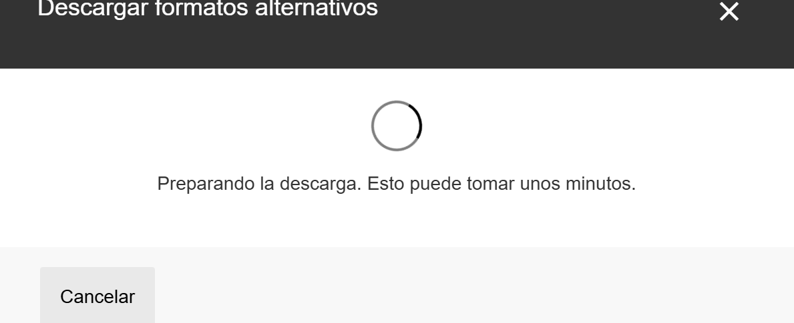

# 1. Descubrimiento de requisitos

Responsable: Adolfo Gaete (parte A) y Daniela Barrientos (parte B)

Texto copiado del informe.

## Problema de interacción

Blackboard muestra los menús, los anuncios y el material de los cursos con una sola apariencia: fondo blanco y letra de tamaño fijo. Todo se lee con la vista. Como las opciones de accesibilidad que existen no están a la vista, el estudiante recurre al zoom del navegador o al modo oscuro del sistema, que desordenan el diseño o no funcionan igual en el celular. En la clase en vivo desde el celular (Blackboard Collaborate), la presentación o pizarra del docente se ve pequeña y no se puede ampliar bien.

Blackboard tiene una herramienta de accesibilidad, Ally, que el equipo no conocía. Al hacer clic en el ícono junto a un archivo del curso (por ejemplo, ihc\_ce\_u2.pdf), ofrece bajarlo en otros formatos: HTML, ePub, braille electrónico, Enhanced Reader, Audio en MP3, BeeLine Reader, Lector inmersivo y versión traducida. En la prueba, la única opción era descargar; no había forma de escuchar o leer el archivo en línea. La descarga del audio llevaba más de 10 minutos sin terminar, así que no pudimos comprobar si permite pausar o cambiar la velocidad.

*Figura 1: """Problemas para descargar formatos alternativos""" (Elaboración propia).*

| Función buscada | Qué ofrece Ally hoy | Qué falta |
| --- | --- | --- |
| Modo oscuro | Temas de color en Enhanced Reader, en el archivo descargado | La plataforma (menús, anuncios, cursos) sigue en blanco |
| Lectura en voz alta con pausa y velocidad | Audio MP3 para descargar | No se escucha en línea; la descarga tardó más de 10 minutos; pausa y velocidad sin comprobar |
| Tamaño de letra ajustable | Sin comprobar (posible dentro de Enhanced Reader) | No aplica a la plataforma |
| Dictado por voz | Nada | No existe |
| Zoom en clase en vivo desde el celular | Nada | Ally no funciona en Collaborate |

*Tabla 1: """Lo que se ve en blackboard""" (Elaboración propia).*

Por lo tanto, el problema es de acceso más que de falta de funciones. Lo que existe está detrás de un ícono pequeño, funciona archivo por archivo y obliga a descargar y esperar, algo difícil para alguien con poca experiencia digital o que ese día no se siente bien.

Para el estudiante, esto se traduce en cansancio visual cuando lee de noche o por varias horas, y en molestia si un día tiene dolor de cabeza y la pantalla blanca le encandila. A quien tiene baja visión o dislexia, o simplemente prefiere escuchar, le cuesta avanzar en textos largos. Con un brazo lesionado no puede escribir en foros ni en evaluaciones. Y si sigue la clase desde el teléfono, se pierde lo que el docente muestra en pantalla.

Desde los contenidos del curso, esto corresponde a un problema de usabilidad y no de funcionamiento. La norma ISO 9241-11 entiende la usabilidad como el grado en que usuarios específicos alcanzan sus objetivos con eficacia, eficiencia y satisfacción en un contexto de uso determinado (International Organization for Standardization, 2018, como se citó en Méndez Alegría, 2026a). Blackboard funciona, pero al estudiante le cuesta más de lo necesario leer, escribir y seguir la clase en las condiciones reales en que estudia. Además, las limitaciones de interacción pueden ser situacionales, temporales, fluctuantes o permanentes, y una misma persona puede pasar de una a otra durante el mismo día por cansancio o fatiga (Cruse & Boudreau, 2025, como se citó en Méndez Alegría, 2026a). Por eso el problema no afecta solo a quienes tienen una discapacidad, sino a cualquier estudiante.

Enunciado del problema: Blackboard presenta el contenido de estudio y las clases en vivo de una sola forma, y las opciones para adaptarla no están a la vista ni integradas en la plataforma. Como consecuencia, leer el contenido, escribir y seguir lo que se presenta en clase exige más esfuerzo del necesario cuando cambia la condición del estudiante o el dispositivo desde el que se conecta.

## Usuario objetivo

Usuario principal: estudiante de la U. Mayor, desde los 18 años hasta adultos de 40 o más. Algunos manejan bien la tecnología y otros recién están aprendiendo a usar un computador. Entra a Blackboard a diario, desde el notebook o el celular.

Además de las discapacidades permanentes, cualquier usuario puede tener una temporal (un dolor de cabeza que hace molesta la luz, un brazo lesionado) o una situacional (estudiar de noche, leer en el transporte). El diseño tiene que servir también en esos casos.

| Perfil | Necesidad principal | Función que lo atiende |
| --- | --- | --- |
| Estudia de noche o muchas horas seguidas | Reducir el brillo y la fatiga visual | Modo oscuro |
| Un día con dolor de cabeza o sensibilidad a la luz (temporal) | Bajar el brillo y descansar la vista | Modo oscuro y lectura en voz alta |
| Baja visión o usa lentes | Leer sin ampliar toda la página | Tamaño de letra ajustable |
| Adulto con poca experiencia digital | Encontrar las opciones sin perderse | Panel simple, siempre en el mismo lugar |
| Dislexia, TDAH o aprendizaje auditivo | Escuchar el texto a su ritmo | Lectura en voz alta con pausa y velocidad |
| Brazo o mano lesionada (temporal) | Escribir y estudiar sin teclado | Dictado por voz y lectura en voz alta |
| Se conecta desde el celular (trayecto, trabajo) | Ver el contenido compartido en clase | Zoom en la clase en vivo de Collaborate |

*Tabla 2: """Perfiles dentro de ese grupo""" (Elaboración propia).*

Usuario secundario: los docentes, que publican el contenido. Si la plataforma permite adaptar la lectura, no tienen que preparar el material en otros formatos.

Para representar al usuario principal se construyó la siguiente persona. Es un perfil ficticio, elaborado a partir de la experiencia del equipo como estudiantes que usan la plataforma, y sirve como referencia para las decisiones de diseño de los apartados siguientes.

| Nombre y edad | Camila Rojas, 23 años (persona ficticia). |
| --- | --- |
| Ocupación | Estudiante de tercer año de Ingeniería en la U. Mayor. Trabaja en jornada completa en una oficina, frente al computador. |
| Dispositivos | Notebook, donde estudia y entrega sus trabajos, y celular, donde revisa anuncios, lee material y sigue las clases en vivo. |
| Rutina de estudio | Lee el contenido de la semana de noche, después del trabajo. Algunos días se conecta a la clase en vivo de Blackboard Collaborate desde el celular, mientras vuelve a su casa. |
| Objetivos | Leer el contenido antes de cada clase.  Seguir lo que muestra el docente sin perder detalles.  Terminar la sesión de estudio sin dolor de cabeza. |
| Frustraciones | La pantalla blanca le molesta de noche.  Después de todo el día frente a una pantalla, le cuesta seguir leyendo textos largos.  En el celular no alcanza a leer la presentación ni la pizarra del docente.  No sabía que la plataforma tenía opciones de accesibilidad, porque no están a la vista. |
| Necesidades | Opciones simples, a la vista y siempre en el mismo lugar.  Poder escuchar el contenido cuando ya no quiere leer.  Que sus ajustes queden guardados y aparezcan igual en el notebook y en el celular. |
| Manejo tecnológico | Alto. Usa modo oscuro en su celular y escucha podcasts a diario. |
| Frase que la representa | "Después de ocho horas frente a la pantalla en el trabajo, lo último que quiero es leer treinta páginas en fondo blanco." |

*Tabla 3: """Usuario objetivo""" (Elaboración propia).*

## Contexto de uso

El estudiante usa Blackboard en su casa, en el campus (biblioteca, salas) y en el transporte público. Estudia y entrega desde el notebook; en el celular revisa anuncios, lee material y sigue las clases en vivo por Blackboard Collaborate. El uso sube de noche y en semanas de evaluaciones, con sesiones de lectura largas. Muchas veces hay poca luz, la pantalla es pequeña o la conexión móvil falla. En el transporte también hay ruido, así que la lectura en voz alta se escucharía con audífonos.

La siguiente tabla ordena el contexto según dónde, cuándo y cómo se usa la plataforma, e indica qué exige cada condición al diseño.

| Dimensión | Descripción | Qué exige al diseño |
| --- | --- | --- |
| Dónde | En la casa, en el campus (biblioteca, salas) y en el transporte público, muchas veces con poca luz o con ruido. | Modo oscuro para bajar el brillo, y lectura en voz alta con audífonos cuando no se puede mirar la pantalla. |
| Cuándo | A diario, con más uso de noche y en semanas de evaluaciones, en sesiones de lectura largas. Las clases en vivo tienen horario fijo. | Guardar las preferencias, para no configurar todo de nuevo en cada ingreso. |
| Cómo | En el notebook estudia y entrega; en el celular revisa anuncios, lee material y sigue las clases en vivo por Blackboard Collaborate. La pantalla es pequeña y la conexión móvil a veces falla. | Que las funciones operen igual en computador y celular, y que el contenido de la clase se pueda ampliar. |
| Estado del usuario | Cansancio visual, menor atención al final del día y, a veces, dolor de cabeza o una lesión temporal. | Acceso en uno o dos toques, efecto inmediato y dictado por voz como alternativa al teclado. |
| Entorno social | Estudia solo. En la clase en vivo comparte la sesión con el docente y sus compañeros. | Que el zoom cambie solo la vista propia, sin afectar a los demás. |

*Tabla 4: """Diseño de la interfaz""". (Elaboración propia).*

## Tarea principal

Leer y comprender el material escrito de un curso (por ejemplo, las instrucciones de una evaluación o el texto de una unidad), ajustando la interfaz a sus necesidades. Pasos:

1) entrar al curso, 2) abrir el contenido, 3) activar modo oscuro o cambiar el tamaño de letra, 4) escuchar el texto y pausarlo o cambiar la velocidad, 5) volver a la lectura visual cuando lo necesite.

Tareas secundarias: responder en un foro o en una evaluación dictando en vez de escribir, y seguir una clase en Blackboard Collaborate desde el celular ampliando el contenido que comparte el docente.

## Lista de requisitos iniciales

| ID | Requisito | Tipo | Prioridad |
| --- | --- | --- | --- |
| RF1 | Activar y desactivar modo oscuro en toda la plataforma (menús, cursos y contenido) | Funcional | Alta |
| RF2 | Ajustar el tamaño de letra en al menos 4 niveles sin desordenar la página | Funcional | Alta |
| RF3 | Leer en voz alta el contenido escrito de una página, con reproducir, pausar y retomar | Funcional | Alta |
| RF4 | Cambiar la velocidad de lectura (por ejemplo 0,75x a 2x) | Funcional | Alta |
| RF5 | Resaltar el texto que se está leyendo para seguirlo con la vista | Funcional | Media |
| RF6 | Ampliar con gesto de pellizco el contenido compartido en la clase en vivo desde el celular | Funcional | Media |
| RF7 | Guardar las preferencias en la cuenta del usuario y aplicarlas en cualquier dispositivo | Funcional | Alta |
| RF8 | Dictar por voz en cualquier campo de texto (foros, respuestas, mensajes) | Funcional | Alta |
| RNF1 | Acceder a las funciones en máximo 2 toques o clics desde cualquier página | Usabilidad | Alta |
| RNF2 | Cumplir contraste y tamaño de texto según WCAG 2.1 nivel AA, también en modo oscuro | Accesibilidad | Alta |
| RNF3 | Funcionar igual en navegador de computador, navegador móvil y app | Compatibilidad | Alta |
| RNF4 | Voz en español con pronunciación natural | Usabilidad | Media |
| RNF5 | Usarse sin capacitación previa, incluso por personas con poca experiencia digital: íconos y nombres simples, siempre en el mismo lugar | Aprendibilidad | Alta |

*Tabla 5: """Listado de requisitos""". (Elaboración propia).*

