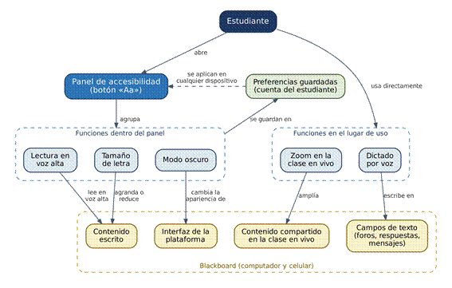

# 3. Modelo conceptual

Responsable: Adolfo Gaete

Texto copiado del informe.

Un modelo conceptual es una descripci贸n de alto nivel sobre c贸mo se organiza y funciona un sistema: qu茅 pueden hacer las personas con 茅l y qu茅 conceptos necesitan manejar para usarlo (Rogers et al., 2023, como se cit贸 en M茅ndez Alegr铆a, 2026b). No define todav铆a colores ni pantallas; ordena la l贸gica sobre la que despu茅s se dise帽a la interfaz.

## Qu茅 har谩 el sistema

La soluci贸n es el panel de accesibilidad integrado en Blackboard, que corresponde a la alternativa A. Un bot贸n fijo "Aa", ubicado siempre en el mismo lugar de la barra superior, abre el panel. El sistema re煤ne cinco funciones con las que el estudiante adapta la forma en que ve, escucha y escribe en la plataforma:

| Funci贸n | Qu茅 hace | D贸nde se usa |
| --- | --- | --- |
| Modo oscuro | Cambia toda la plataforma (men煤s, cursos y contenido) entre apariencia clara y oscura. | Interruptor dentro del panel. |
| Tama帽o de letra | Agranda o reduce el texto por niveles, sin desordenar la p谩gina. | Botones A"�� / A+ dentro del panel. |
| Lectura en voz alta | Lee en l铆nea el contenido escrito de la p谩gina, con reproducir, pausar, retomar y cambio de velocidad, y resalta el texto que se est谩 leyendo. | Reproductor dentro del panel. |
| Dictado por voz | Convierte la voz en texto en foros, respuestas y mensajes. | Bot贸n de micr贸fono en cada campo de texto. |
| Zoom en la clase en vivo | Ampl铆a el contenido que comparte el docente en Blackboard Collaborate desde el celular. | Gesto de pellizco o doble toque sobre el contenido. |

*Tabla 6: """Descripci贸n de la soluci贸n""". (Elaboraci贸n propia.)*

El sistema aplica cada cambio de inmediato, guarda las preferencias en la cuenta del estudiante y las aplica en cualquier dispositivo desde el que vuelva a entrar. La propuesta no modifica el contenido que publica el docente ni reemplaza tecnolog铆as de apoyo como los lectores de pantalla; solo cambia la forma en que el contenido se presenta y la forma en que el estudiante ingresa texto.

## Elementos del modelo conceptual

La siguiente tabla ordena la propuesta seg煤n los elementos de un modelo conceptual: conceptos, objetos de interacci贸n, acciones, relaciones y experiencia que se busca apoyar.

| Elemento del modelo | Aplicaci贸n en la propuesta |
| --- | --- |
| Conceptos principales | Panel de accesibilidad, funci贸n de accesibilidad, modo oscuro, tama帽o de letra, lectura en voz alta, dictado por voz, zoom en la clase en vivo, contenido del curso, clase en vivo y preferencias guardadas. |
| Objetos de interacci贸n | Bot贸n "Aa", interruptor de modo oscuro, botones A"�� / A+, reproductor de lectura (reproducir o pausar, y velocidad), bot贸n de micr贸fono en los campos de texto y contenido compartido en la clase en vivo. |
| Acciones posibles | Abrir y cerrar el panel; activar y desactivar el modo oscuro; aumentar y disminuir la letra; reproducir, pausar, retomar y cambiar la velocidad de la lectura; dictar un texto; ampliar y desplazar el contenido de la clase. |
| Relaciones entre conceptos | El panel agrupa el modo oscuro, el tama帽o de letra y la lectura en voz alta. El dictado se usa desde cada campo de texto, y el zoom, sobre el contenido de la clase en vivo. Cada funci贸n cambia c贸mo se presenta el contenido o c贸mo se ingresa el texto, no el contenido mismo. Las preferencias se guardan en la cuenta del estudiante y se aplican en cualquier dispositivo. |
| Experiencia que se busca apoyar | Que Blackboard se adapte a la condici贸n de cada usuario: estudiar, escribir y seguir las clases con comodidad y sensaci贸n de control, sin instalar ni descargar nada. |

*Tabla 7: """Elementos del modelo""" (elaboraci贸n propia, a partir de la estructura de modelo conceptual presentada en M茅ndez Alegr铆a (2026b).)*

## Conceptos que debe comprender el usuario

Para usar la soluci贸n, el estudiante necesita manejar pocos conceptos, y casi todos se apoyan en algo que ya conoce de otras aplicaciones. Esto es clave para quien tiene poca experiencia digital.

| Concepto | Qu茅 debe entender el usuario | Conocimiento previo en que se apoya |
| --- | --- | --- |
| Panel de accesibilidad (bot贸n "Aa") | Es el lugar donde se ajusta c贸mo se ve y se escucha Blackboard, y est谩 siempre en el mismo sitio. | Panel de ajustes r谩pidos del celular. |
| Modo oscuro | Fondo oscuro con letra clara en toda la plataforma. | Modo oscuro de aplicaciones y sistemas operativos. |
| Tama帽o de letra | El texto crece o se achica por niveles. | Botones A"�� / A+ de lectores digitales y navegadores. |
| Lectura en voz alta | La plataforma lee el texto de la p谩gina; se puede pausar y retomar, y el texto resaltado indica por d贸nde va la lectura. | Reproductores de m煤sica y de podcasts. |
| Dictado por voz | Al tocar el micr贸fono, lo que dice queda escrito en el campo de texto, y puede corregirlo antes de enviar. | Dictado del teclado del celular y mensajes de voz. |
| Zoom en la clase en vivo | Ampliar solo cambia la vista propia, no la del docente ni la de los compa帽eros. | Pellizco para ampliar fotos y mapas. |
| Preferencias guardadas | Los ajustes quedan en su cuenta y aparecen igual en el notebook y en el celular. | Preferencias de perfil en otras plataformas. |

*Tabla 8: Elementos que debe conocer el usuario. (Elaboraci贸n propia.)*

## Relaciones entre los conceptos

El siguiente diagrama muestra c贸mo se relacionan los conceptos. El estudiante abre el panel, que agrupa tres funciones; las otras dos se usan directamente en el lugar donde se necesitan. Cada funci贸n act煤a sobre una parte distinta de Blackboard, y las preferencias del panel se guardan en la cuenta y se aplican en cualquier dispositivo.

*Figura 2: """Diagrama del modelo conceptual del panel de accesibilidad.""" (Elaboraci贸n propia.)*
